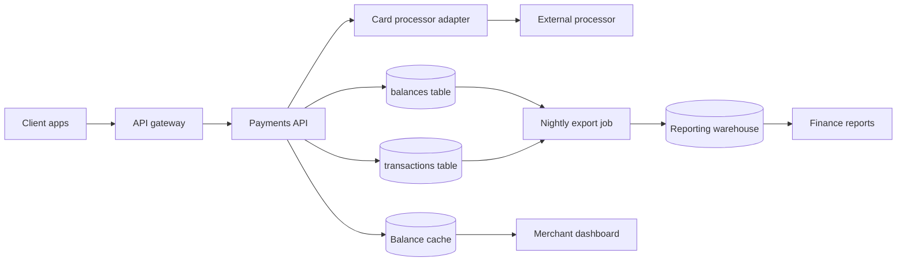
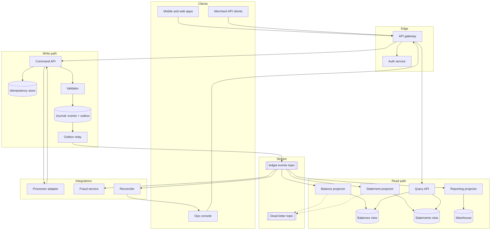
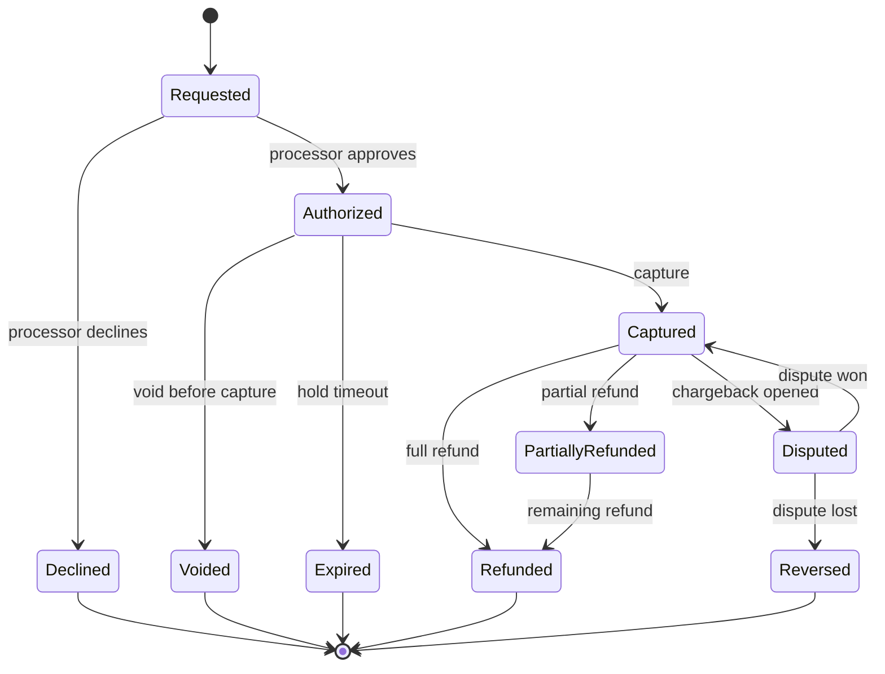
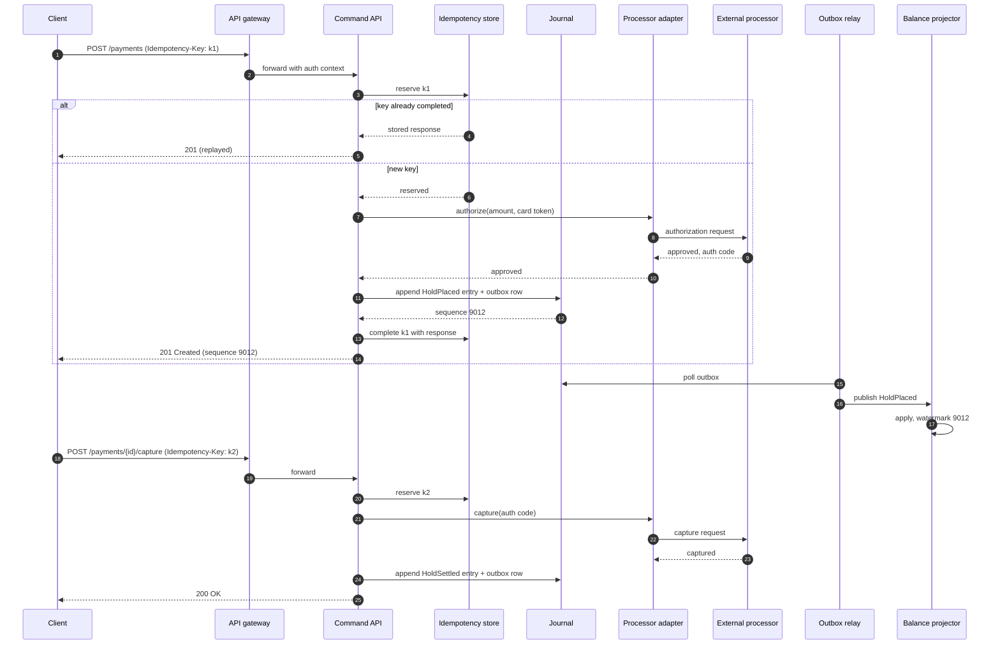
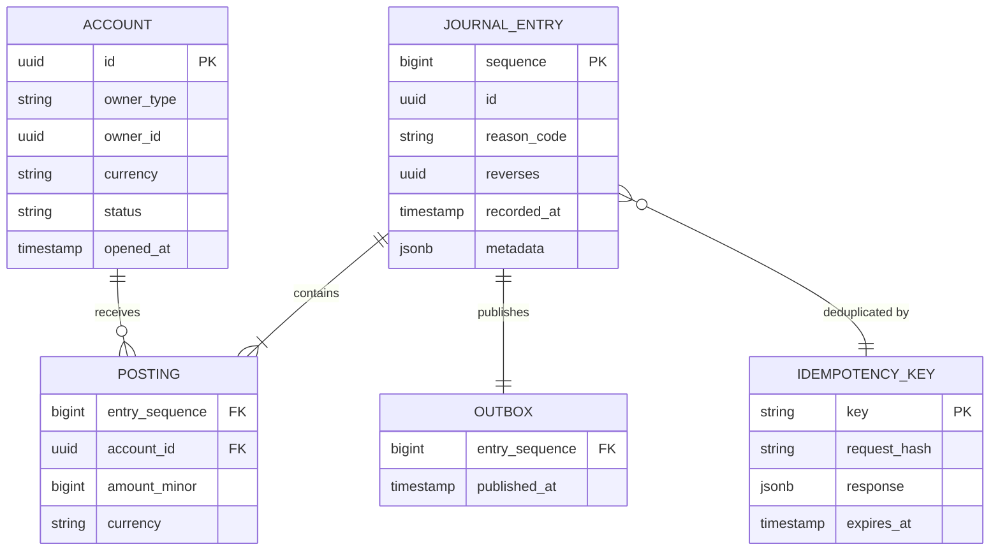
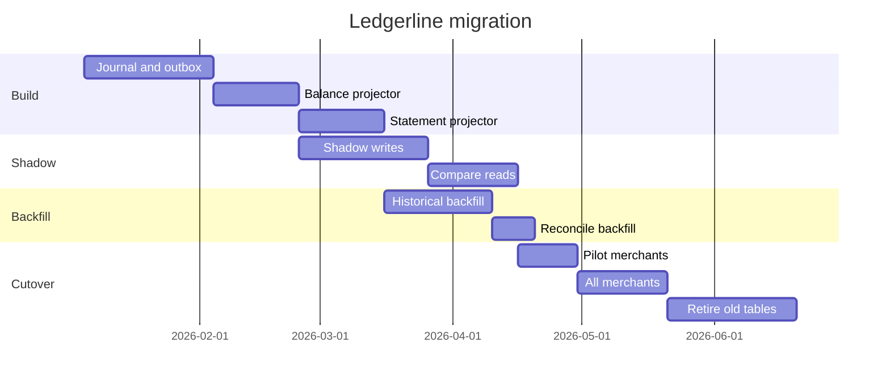
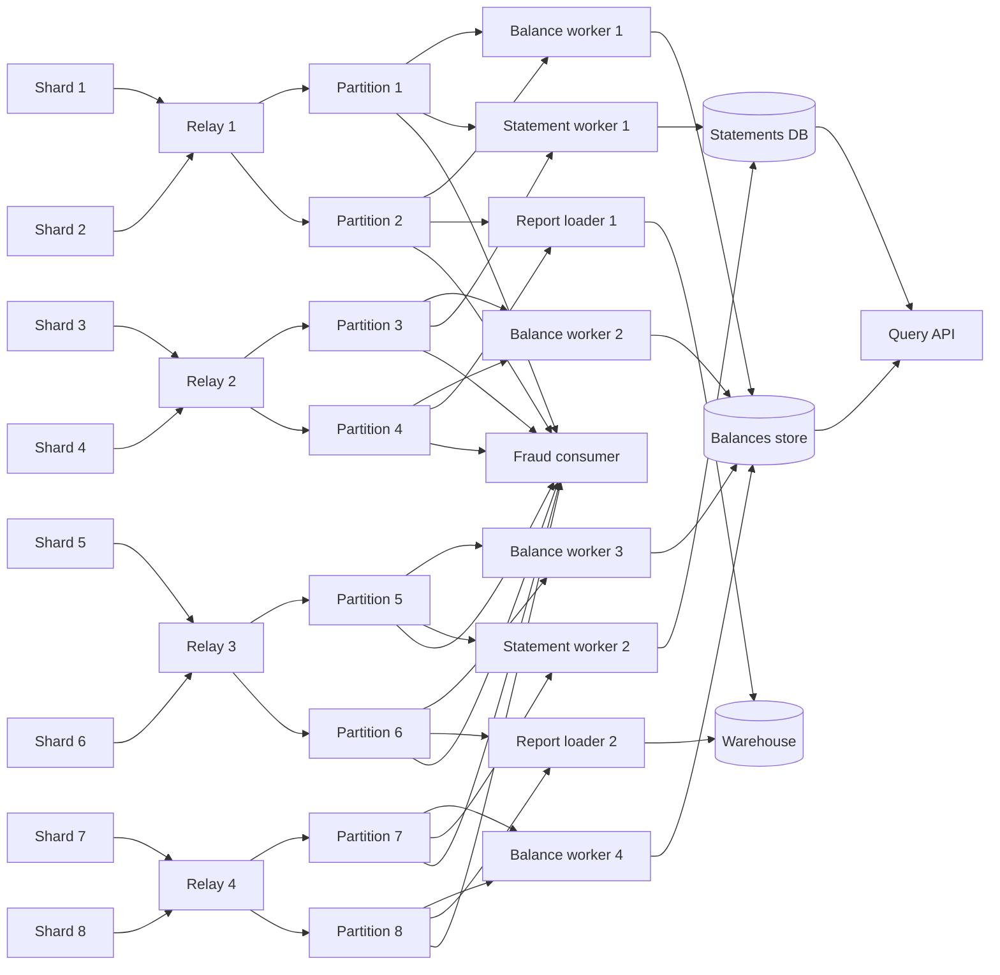

# Ledgerline: payment ledger redesign

Ledgerline is a fictional payment ledger used as docwalk's acceptance
fixture. Every name, number and system in this document is invented. The
document is deliberately long and dense: it has more content per section
than a slide can hold, several large Mermaid diagrams, an oversized table and
a handful of Markdown edge cases collected in the appendix.

| Field | Value |
|---|---|
| Status | Draft for review |
| Authors | Platform team (fictional) |
| Reviewers | Payments, SRE, Security |
| Last updated | 2026-11-05 |
| Target release | Q2 |

## Summary

Ledgerline replaces the current mutable balance tables with an append-only
event log. Every money movement becomes an immutable journal entry with two
or more postings that sum to zero. Balances, statements and reports become
projections that can be rebuilt from the log at any time.

The redesign fixes three classes of incident seen over the last year:
double-applied refunds after retries, balances that drift from the sum of
their transactions, and reports that disagree with the dashboard because
they read from different tables. It also lets the team answer "what did this
account look like at 14:03 last Tuesday?" without restoring a backup.

> [!NOTE]
> This document describes the target design. The migration section explains
> how the old and new systems run side by side until cutover.

## Goals and non-goals

### Goals

- Every money movement is recorded exactly once, even when clients retry.
- Every balance equals the sum of its postings, checked continuously.
- Any account's state can be reconstructed for any past instant.
- Writes stay under 50 ms at p99 for single-currency transfers.
- Reads for the dashboard stay under 20 ms at p99.
- Projections can be rebuilt without downtime.
- The audit trail satisfies the external auditor's retention rules.

### Non-goals

- Replacing the card processor integration. It keeps its current adapter.
- Multi-region active-active writes. One write region remains the source of
  truth; other regions serve reads.
- Real-time fraud scoring. The fraud service consumes the event stream but
  stays a separate system.
- A general-purpose event-sourcing framework for other teams.

## Glossary

| Term | Meaning |
|---|---|
| Account | A named bucket of value in one currency, owned by a customer, a merchant or the platform |
| Posting | One signed amount against one account |
| Journal entry | A set of postings that sum to zero, written atomically |
| Event | The immutable record of a journal entry plus its metadata |
| Projection | A read model derived from events, such as balances or statements |
| Idempotency key | A client-supplied key that makes a retried request a no-op |
| Hold | A reservation of funds that has not settled |
| Settlement | The moment a hold becomes a final movement |
| Reversal | A new journal entry that cancels an earlier one; events are never deleted |
| Watermark | The highest event sequence number a projection has applied |
| Snapshot | A stored projection state at a given watermark, used to speed up rebuilds |
| Outbox | A table written in the same transaction as the event, drained to the stream |
| Reconciler | The job that compares projections with the log and with external statements |
| Cutover | The switch from the old balance tables to Ledgerline as the source of truth |

## Current architecture

The current system writes balances in place. The API service updates the
`balances` table and inserts a row into `transactions` in the same request,
but not always in the same database transaction. Reports read from a nightly
copy.



## Problems with the current system

1. Refunds retried after a timeout can apply twice, because the API checks
   for duplicates after the balance update instead of before it.
2. The balance update and the transaction insert sometimes land in separate
   transactions, so a crash between them leaves a balance without a matching
   transaction.
3. The balance cache expires on a timer, so the dashboard can show a value up
   to 60 seconds old.
4. The nightly export reads both tables at slightly different moments, so
   reports can disagree with each other by the transactions written during
   the export window.
5. There is no way to see an account's balance at a past instant without
   restoring a backup.
6. Corrections are made by editing rows, which leaves no record of who
   changed what.
7. Currency conversion writes two balance updates with no shared identifier,
   so a partial failure leaves one side converted.
8. Holds are stored as a column on the balance row, so concurrent holds on
   the same account contend on one row lock.
9. The schema has grown 14 nullable columns that only some transaction types
   use.
10. Load tests show lock contention above 800 writes per second on popular
    merchant accounts.
11. The reconciliation job runs weekly and takes nine hours.
12. Alerts fire on reconciliation mismatches but do not say which entry
    caused them.
13. Backfills run as ad hoc scripts against production.
14. The processor adapter retries on its own and the API also retries,
    multiplying attempts during an outage.
15. Test environments share one database, so integration tests interfere with
    each other.
16. Deleting a test merchant cascades into financial history.
17. The API returns different error shapes from different endpoints.
18. There is no contract test between the API and the dashboard.
19. On-call engineers need database access to answer common support
    questions.
20. Audit exports are built by hand once a quarter.
21. Time zones are stored inconsistently across tables.
22. Some amounts are stored as floating-point numbers.

## Proposed architecture

Ledgerline splits the system into a write path that appends events and a
read path that serves projections. The outbox pattern moves events from the
database to the stream without a distributed transaction.



### Write path

The command API accepts a request, checks the idempotency store, validates
the postings and writes one journal entry. The journal entry, its postings
and an outbox row commit in one database transaction. Nothing else in the
write path touches a balance.

Validation rules:

- Postings in one entry sum to zero per currency.
- Every account exists, is open and uses the posting's currency.
- A debit that would take a customer account below zero needs an active hold
  or an overdraft allowance.
- Amounts are integers in the currency's minor unit.
- The entry carries a reason code from the fixed list in the appendix.

### Read path

Projectors consume the stream in order per account and update their views.
Each view stores its watermark, so a projector can resume after a restart and
the query API can tell a client how fresh a read is. A client that just wrote
can pass the sequence number it got back and ask the query API to wait until
the view reaches it.

### Projections

| Projection | Store | Freshness target | Rebuild time (est.) |
|---|---|---|---|
| Balances | Key-value store | under 1 s | 40 min |
| Statements | Relational | under 5 s | 3 h |
| Reporting | Warehouse | under 15 min | 9 h |
| Fraud features | Feature store | under 2 s | 6 h |

Rebuilds run into a new table and swap atomically when the new table's
watermark catches up with the live one.

## Payment lifecycle



Every arrow in the diagram writes one journal entry. A state is a
projection over those entries; nothing stores the state as a mutable field.

## Request flow: authorize and capture



## Data model



The journal schema, simplified:

```sql
CREATE TABLE journal_entry (
  sequence     BIGSERIAL PRIMARY KEY,
  id           UUID        NOT NULL UNIQUE,
  reason_code  TEXT        NOT NULL,
  reverses     UUID        REFERENCES journal_entry (id),
  recorded_at  TIMESTAMPTZ NOT NULL DEFAULT now(),
  metadata     JSONB       NOT NULL DEFAULT '{}'
);

CREATE TABLE posting (
  entry_sequence BIGINT NOT NULL REFERENCES journal_entry (sequence),
  account_id     UUID   NOT NULL REFERENCES account (id),
  amount_minor   BIGINT NOT NULL CHECK (amount_minor <> 0),
  currency       CHAR(3) NOT NULL,
  PRIMARY KEY (entry_sequence, account_id, currency)
);

-- Enforced by a deferred constraint trigger: postings in one entry sum to zero per currency.
```

## API

| Method | Path | Purpose | Idempotent |
|---|---|---|---|
| `POST` | `/payments` | Authorize and place a hold | Yes, by key |
| `POST` | `/payments/{id}/capture` | Settle a hold | Yes, by key |
| `POST` | `/payments/{id}/void` | Release a hold before capture | Yes, by key |
| `POST` | `/payments/{id}/refunds` | Refund all or part of a capture | Yes, by key |
| `POST` | `/transfers` | Move funds between two accounts | Yes, by key |
| `GET` | `/accounts/{id}/balance` | Current balance and watermark | Read |
| `GET` | `/accounts/{id}/balance?at=` | Balance at a past instant | Read |
| `GET` | `/accounts/{id}/entries` | Paged journal entries | Read |
| `GET` | `/entries/{id}` | One journal entry with postings | Read |

A transfer request:

```json
{
  "idempotencyKey": "7b2f0c4e-0d1a-4c55-9a51-6c1f2a9e3d10",
  "reasonCode": "MERCHANT_PAYOUT",
  "postings": [
    { "account": "acct_merchant_0042", "amountMinor": -125000, "currency": "EUR" },
    { "account": "acct_payout_clearing", "amountMinor": 125000, "currency": "EUR" }
  ],
  "metadata": { "payoutBatch": "2026-11-05-am" }
}
```

Every error uses one shape, following `application/problem+json`:

```json
{
  "type": "https://ledgerline.example/errors/unbalanced-entry",
  "title": "Postings do not sum to zero",
  "status": 422,
  "detail": "EUR postings sum to 500, expected 0",
  "instance": "/transfers"
}
```

## Idempotency

The idempotency store keeps the request hash and the final response for each
key for 72 hours. A retry with the same key and the same body gets the stored
response. A retry with the same key and a different body gets `409 Conflict`,
because the client reused a key for a different operation.

```ts
export async function withIdempotency<T>(
  store: IdempotencyStore,
  key: string,
  requestHash: string,
  run: () => Promise<T>,
): Promise<T> {
  const existing = await store.reserve(key, requestHash);
  if (existing.state === "completed") {
    if (existing.requestHash !== requestHash) throw new ConflictError(key);
    return existing.response as T;
  }
  if (existing.state === "in_flight") throw new RetryLaterError(key);

  try {
    const response = await run();
    await store.complete(key, response);
    return response;
  } catch (error) {
    await store.release(key);
    throw error;
  }
}
```

The reservation is a row insert with a unique constraint, so two concurrent
requests with the same key cannot both pass it.

## Failure handling

### Retries

Clients retry with the same idempotency key and exponential backoff starting
at 200 ms, capped at 10 s, with full jitter. The processor adapter does not
retry on its own any more; the command API owns the retry budget so one
outage cannot multiply attempts.

| Failure | Retry? | Who retries | Budget |
|---|---|---|---|
| Network timeout to processor | Yes | Command API | 3 attempts |
| Processor 5xx | Yes | Command API | 3 attempts |
| Processor decline | No | Nobody | 0 |
| Validation error | No | Nobody | 0 |
| Database serialization failure | Yes | Command API | 5 attempts |
| Outbox publish failure | Yes | Relay | Unlimited, with alerting |

### Timeouts

- Gateway to command API: 3 s.
- Command API to processor adapter: 2.5 s per attempt.
- Command API to database: 500 ms per statement.
- Projector apply: 200 ms per event before the event is parked.

A timeout after the processor approved but before the journal write is the
dangerous case: money moved at the processor, nothing recorded here. The
reconciler compares processor reports with the journal every 15 minutes and
writes a compensating entry, flagged for review, when it finds an approved
authorization with no matching hold.

### Poison messages

A projector that fails to apply one event three times parks it on the
dead-letter topic and stops advancing for that account only. Other accounts
keep flowing. An alert names the account, the event sequence and the error.
An operator fixes the projector, then replays the parked event from the ops
console.

### Partial failures

Currency conversion writes one journal entry with four postings: the source
debit, the source-currency clearing credit, the target-currency clearing
debit and the target credit. Because all four commit together, a crash
cannot leave one side converted.

### Duplicate delivery

The stream delivers at least once. Projectors store the last applied
sequence per account and skip any event at or below it. The fraud service
uses the event id as its own idempotency key.

### Clock skew

Event order comes from the journal sequence, never from timestamps. The
`recorded_at` column is informational. Balance-at-time queries map the
requested instant to the highest sequence recorded before it.

## Configuration flags

| Flag | Default | Scope | Owner | Description |
|---|---|---|---|---|
| `ledger.write.enabled` | `false` | Global | Platform | Route writes through Ledgerline |
| `ledger.write.shadow` | `true` | Global | Platform | Write to Ledgerline in parallel with the old tables |
| `ledger.read.balances` | `old` | Per merchant | Platform | Which system serves balance reads: `old`, `new`, `compare` |
| `ledger.read.statements` | `old` | Per merchant | Platform | Which system serves statements |
| `ledger.compare.sample_rate` | `0.05` | Global | SRE | Share of reads compared between systems |
| `ledger.compare.alert_threshold` | `10` | Global | SRE | Mismatches per minute before paging |
| `ledger.idempotency.ttl_hours` | `72` | Global | Payments | How long idempotency keys are kept |
| `ledger.idempotency.max_body_kb` | `64` | Global | Payments | Largest request body hashed for idempotency |
| `ledger.outbox.batch_size` | `500` | Global | Platform | Rows per relay poll |
| `ledger.outbox.poll_ms` | `50` | Global | Platform | Relay poll interval |
| `ledger.projector.balances.parallelism` | `32` | Global | Platform | Partitions processed in parallel |
| `ledger.projector.statements.parallelism` | `16` | Global | Platform | Partitions processed in parallel |
| `ledger.projector.park_after_failures` | `3` | Global | SRE | Failures before an event is parked |
| `ledger.projector.apply_timeout_ms` | `200` | Global | SRE | Time budget per event |
| `ledger.snapshot.every_events` | `10000` | Per projection | Platform | Events between snapshots |
| `ledger.snapshot.retention_days` | `30` | Per projection | Platform | How long snapshots are kept |
| `ledger.rebuild.max_concurrency` | `2` | Global | SRE | Rebuilds allowed at once |
| `ledger.rebuild.throttle_eps` | `20000` | Global | SRE | Events per second during a rebuild |
| `ledger.processor.timeout_ms` | `2500` | Per processor | Payments | Per-attempt processor timeout |
| `ledger.processor.max_attempts` | `3` | Per processor | Payments | Attempts per request |
| `ledger.hold.expiry_hours` | `168` | Per merchant | Payments | When an uncaptured hold expires |
| `ledger.overdraft.enabled` | `false` | Per account | Risk | Allow negative balances up to the limit |
| `ledger.overdraft.limit_minor` | `0` | Per account | Risk | Overdraft limit in minor units |
| `ledger.reconcile.interval_min` | `15` | Global | Finance | Processor reconciliation interval |
| `ledger.reconcile.auto_compensate` | `false` | Global | Finance | Write compensating entries without review |
| `ledger.audit.export.enabled` | `true` | Global | Compliance | Produce the daily audit export |
| `ledger.audit.export.format` | `parquet` | Global | Compliance | `parquet` or `csv` |
| `ledger.query.wait_for_sequence_ms` | `1000` | Global | Platform | Longest a read waits for a watermark |
| `ledger.query.page_size` | `100` | Global | Platform | Default page size for entry listings |
| `ledger.query.max_page_size` | `1000` | Global | Platform | Largest page a client can request |
| `ledger.multicurrency.enabled` | `true` | Global | Payments | Allow conversion entries |
| `ledger.multicurrency.rate_source` | `treasury` | Global | Treasury | Where conversion rates come from |
| `ledger.dlq.alert_after` | `1` | Global | SRE | Parked events before alerting |
| `ledger.ops.replay.enabled` | `true` | Global | SRE | Allow replay from the ops console |
| `ledger.ops.replay.require_approval` | `true` | Global | SRE | Second operator must approve a replay |
| `ledger.migration.backfill.enabled` | `false` | Global | Platform | Run the historical backfill |
| `ledger.migration.backfill.batch` | `5000` | Global | Platform | Rows per backfill batch |
| `ledger.migration.cutover.merchants` | `[]` | Global | Platform | Merchants already cut over |
| `ledger.metrics.histogram_buckets` | `default` | Global | SRE | Latency histogram buckets |
| `ledger.tracing.sample_rate` | `0.01` | Global | SRE | Share of requests traced end to end |

## Migration plan



- [x] Agree on the journal schema
- [x] Prototype the outbox relay
- [ ] Load-test 5,000 writes per second on one merchant account
- [ ] Shadow writes for all traffic
- [ ] Compare reads at 5% for two weeks with zero unexplained mismatches
- [ ] Backfill five years of history
- [ ] Pilot with ten merchants
- [ ] Cut over everyone
- [ ] Freeze and archive the old tables

## Rollout

1. Turn on `ledger.write.shadow` for internal test merchants.
2. Watch the comparison dashboard for 48 hours.
3. Extend shadow writes to all traffic.
4. Turn on `compare` reads at a 5% sample.
5. Fix every mismatch class, with a regression test for each.
6. Run the historical backfill in batches outside business hours.
7. Reconcile the backfill against the old tables.
8. Switch ten pilot merchants to `new` reads.
9. Switch writes for the pilot merchants.
10. Expand in waves of 10%, 25%, 50% and 100%.
11. Keep the old tables read-only for 30 days.
12. Archive the old tables.

> [!WARNING]
> Never switch reads to `new` for a merchant before its backfill has
> reconciled. A merchant would see a balance without its history.

> [!TIP]
> The comparison dashboard groups mismatches by reason code, which usually
> points straight at the transaction type with the bug.

## Observability

| Metric | Type | Alert |
|---|---|---|
| `ledger_write_latency_seconds` | Histogram | p99 above 50 ms for 10 min |
| `ledger_outbox_lag_rows` | Gauge | Above 10,000 for 5 min |
| `ledger_projector_watermark_lag_events` | Gauge, per projection | Above 50,000 for 5 min |
| `ledger_parked_events_total` | Counter | Any increase |
| `ledger_compare_mismatch_total` | Counter, by reason | Above threshold per minute |
| `ledger_reconcile_unmatched_total` | Counter | Any increase |
| `ledger_idempotency_conflicts_total` | Counter | Spike above baseline |

```promql
histogram_quantile(
  0.99,
  sum by (le, endpoint) (rate(ledger_write_latency_seconds_bucket[5m]))
) > 0.05
```

Every journal entry carries the trace id of the request that wrote it, so a
support engineer can go from an entry in the ops console to the full request
trace.

## Security

- Only the command API can write to the journal; its database role has
  `INSERT` on journal tables and nothing else.
- Projectors use a role that can read the stream and write their own views.
- Reversals require a reason code and, above a configurable amount, a second
  approver.
- The ops console never edits events. Corrections are new entries.
- PII stays out of the journal. Entries reference account ids; customer
  details live in the customer service.
- Audit exports are signed, and their checksums are stored in a separate
  account.

> Treat the journal like a bank's paper ledger: you can add a line that
> corrects an earlier line, but you never erase one.

## Alternatives considered

| Option | Pros | Cons | Verdict |
|---|---|---|---|
| Fix the current tables in place | Smallest change | Keeps mutable balances and the drift they cause | Rejected |
| Buy a ledger product | Mature, audited | Licence cost, data residency concerns, poor fit for holds | Rejected |
| Event sourcing with a general framework | Rich tooling | Framework lock-in, more concepts than the team needs | Rejected |
| Double-entry journal with projections (this design) | Simple model, rebuildable reads, clear audit | New operational surface: stream, projectors, rebuilds | Chosen |

The team rejected a ledger product mainly because holds and partial captures
needed workarounds in every product evaluated, and those workarounds would
have reintroduced mutable state.

## Open questions

- [ ] Should balance-at-time queries go through snapshots or replay from the
      nearest checkpoint?
- [ ] Do we need per-merchant stream partitions, or is per-account enough?
- [ ] How long do auditors need parked-event history?
- [ ] Can the reporting projector replace the nightly export entirely?

## Appendix

### A. Reason codes

`CARD_AUTH`, `CARD_CAPTURE`, `CARD_VOID`, `CARD_REFUND`, `CHARGEBACK`,
`CHARGEBACK_REVERSAL`, `MERCHANT_PAYOUT`, `FEE`, `FX_CONVERSION`,
`MANUAL_ADJUSTMENT`, `COMPENSATION`, `HOLD_EXPIRY`.

### B. A paragraph followed by a rule

The next line is three hyphens directly under this paragraph, with no blank
line between. CommonMark reads that as a level-2 setext heading, not as a
slide break, so this whole paragraph becomes a heading.
---

### C. Hyphens inside a fence

The block below contains a line of three hyphens. It is code, not a slide
break.

```yaml
ledger:
  write:
    enabled: false
---
ledger:
  write:
    enabled: true
```

### D. Wide content

| Column 1 | Column 2 | Column 3 | Column 4 | Column 5 | Column 6 | Column 7 | Column 8 | Column 9 | Column 10 | Column 11 | Column 12 |
|---|---|---|---|---|---|---|---|---|---|---|---|
| a long value that wraps | another long value | `inline code value` | 1,234,567.89 | 2026-11-05T14:03:00Z | EUR | acct_merchant_0042 | HOLD_EXPIRY | true | null | an extra wide cell to force horizontal overflow | end |

```text
2026-11-05T14:03:00.123Z INFO command-api entry=9012 key=7b2f0c4e-0d1a-4c55-9a51-6c1f2a9e3d10 reason=CARD_AUTH account=acct_merchant_0042 amount_minor=125000 currency=EUR latency_ms=31 trace=4bf92f3577b34da6a3ce929d0e0e4736
```

### E. A dense diagram

This diagram is too dense for a slide. docwalk should fit it, flag it as too
small to read, and let the presenter zoom into it.



### F. Footnotes, details and an image

The reconciler runs every 15 minutes[^recon]. Snapshots cut rebuild time by
about 80%[^snap].

<details>
<summary>Why not use timestamps for ordering?</summary>

Clocks on different hosts drift. Two entries written a millisecond apart on
different hosts can carry timestamps in the wrong order. The journal
sequence comes from one database, so it gives a total order for free.

</details>


[^recon]: The interval is the `ledger.reconcile.interval_min` flag.
[^snap]: Estimated from the prototype; not yet measured on production data.

***

## Changelog

| Date | Change |
|---|---|
| 2026-11-05 | First complete draft |
| 2026-10-28 | Added failure handling and configuration flags |
| 2026-10-14 | Initial outline |

See the [GitHub Flavored Markdown spec](https://github.github.com/gfm/) and
the [Mermaid documentation](https://mermaid.js.org/) for the syntax this
document uses.
